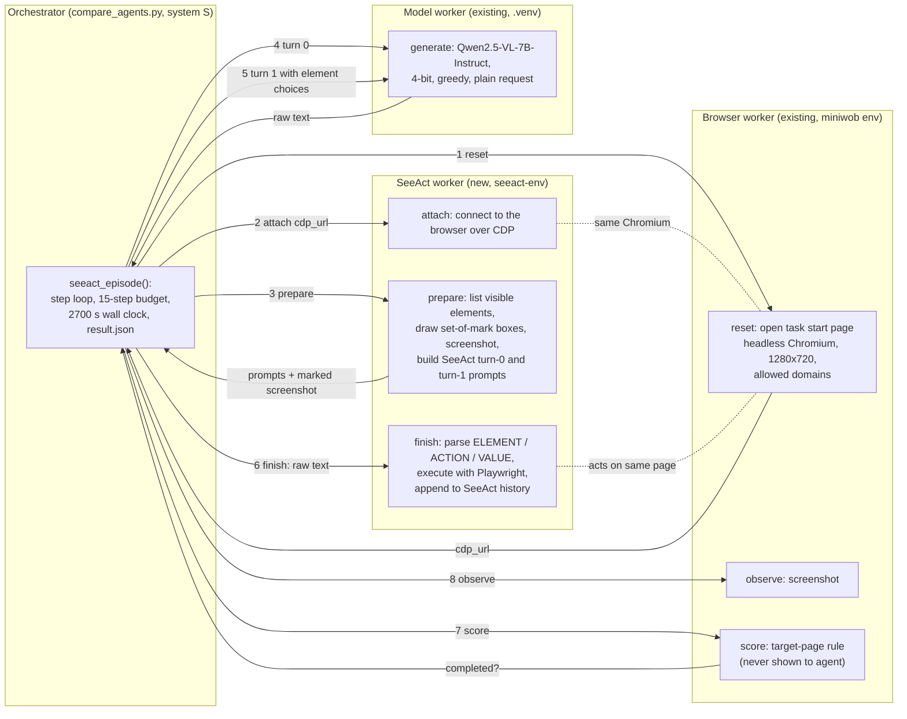

# SeeAct as a second raw baseline agent: analysis and plan

2026-10-07 plan; 2026-10-11 steps 1–5 done: implemented, 7 unit tests, pilot 5/5 completed. See `project_progress.md`.

Goal: run the unmodified SeeAct agent on the same 42 web-v2 tasks with the same
Qwen2.5-VL-7B actor, and report its completion next to Browser Use (72.6 %) and
Browser Use + Ours (85.7 %). Our framework is **not** attached to SeeAct.

## 1. What SeeAct is (read from source)

Source: `github.com/OSU-NLP-Group/SeeAct`, commit `2434627` (2025-02-02),
package `seeact` 0.2.9.0, licence OpenRAIL-S. Cloned (read-only) to
`.task2-assets/external/SeeAct`. Paper: Zheng et al., "GPT-4V(ision) is a
Generalist Web Agent, if Grounded", ICML 2024.

| Part | How it works | File |
|---|---|---|
| Observation | Interactive elements **fully inside the viewport** (Playwright), sorted top-to-bottom; boxes drawn on the page (set-of-mark); screenshot | `demo_utils/browser_helper.py`, `mark_page.js` |
| Step = 2 model calls | Turn 0: free-text reasoning about the page and the next action. Turn 1: same conversation + multiple-choice list of elements (A, B, …) → `ELEMENT / ACTION / VALUE` lines | `agent.py: predict`, `data_utils/format_prompt_utils.py` |
| Parsing | Regex on `ELEMENT:`, `ACTION:`, `VALUE:`; unparsable action → `NONE` | `demo_utils/format_prompt.py: postprocess_action_lmm` |
| Actions | CLICK, TYPE, SELECT, HOVER, PRESS ENTER, SCROLL UP/DOWN, PRESS HOME/END/PAGEUP/PAGEDOWN, GO BACK/FORWARD, GOTO, NEW/CLOSE TAB, TERMINATE, NONE, SAY, MEMORIZE | `agent.py: perform_action` |
| Model access | `engine.generate(prompt, image_path, turn_number, ouput_0)`; only OpenAI / Gemini / Ollama-llava built in | `demo_utils/inference_engine.py` |
| Own recovery | Prompt rule 7 only ("do not generate same action as the previous one"); failed executions are written into the action history | `agent.py` |

## 2. Problems found in the source and how we handle them

| # | Problem | Handling (no change to SeeAct's decision logic) |
|---|---|---|
| 1 | No engine for a local model | New engine class that sends SeeAct's exact two-turn messages to our existing `model_worker` `generate` op (`plain` request, greedy, same 4-bit Qwen2.5-VL-7B) |
| 2 | `normal_launch_async` hard-codes `headless=False` (needs a display) | Do not call `agent.start()`; connect over CDP to the headless Chromium that `web_worker reset` already opens (same start page, viewport 1280×720, user agent as Browser Use) |
| 3 | `predict()` calls the engine synchronously; our model lives in another process | Split one step into `prepare` (elements, marks, screenshot, prompts) → two model calls by the orchestrator → `finish` (parse, execute). The two halves are copies of `predict`/`execute` with only the engine call moved out; diff kept in the repo |
| 4 | `execute()` error path reads `pred_element['description']` when the element is `None` → crash | Catch it, record "failed to perform" in SeeAct's own history (what SeeAct intends) |
| 5 | Package default temperature 0.9; max tokens 4096 | Greedy decoding as for Browser Use. Token limit: see decision D1 |
| 6 | No domain restriction; `GOTO` can leave the site | Block navigation outside the task's `allowed_domains` (as Browser Use does) via Playwright routing; record blocked attempts |
| 7 | `NEW TAB` / `CLOSE TAB` change the active page | Scoring already uses the newest open page (`web_worker.page()`), same as for Browser Use |
| 8 | Package pins `openai==1.24`, `litellm==1.35` (conflict with Browser Use env) | Separate venv `.task2-assets/seeact-env` (Python 3.12, `seeact==0.2.9.0`, `playwright==1.44` to match the browser env); runs as its own worker process |

## 3. Fairness rules (identical to web-v3 unless stated)

| Item | Value |
|---|---|
| Actor | Qwen2.5-VL-7B-Instruct, same 4-bit load, greedy, same processor |
| Tasks | `configs/eval/task2/web_tasks_v2.json`, 42 tasks, 2 repeats |
| Budget | 15 agent steps (one step = one SeeAct predict+execute, i.e. 2 model calls), 2700 s wall clock |
| Start | same `web_worker reset`: start URL, viewport, user agent, allowed domains |
| Completion | same environment scorer (`score` op: target page rule) checked after every step; never shown to the agent; episode stops on completion, on `TERMINATE`, or at budget |
| Records | per step: marked screenshot, both prompts, both raw outputs, parsed action, execution result; `result.json` with the same fields as web-v3 so `compare_agents.py report` works |

## 3b. Architecture of the SeeAct run

Three processes, as in web-v3. The browser worker and the model worker are the
**existing, unchanged** ones; only the SeeAct worker and one orchestrator
function are new. Our framework (P1, recovery, memory) is not in the loop.

Per-step sequence (one SeeAct step = steps 3–8 above):

| # | Call | From → to | What is recorded |
|---|---|---|---|
| 3 | `prepare` | orchestrator → SeeAct worker | `seeact-NNNN-elements.json`, marked screenshot `seeact-NNNN.png`, both prompt texts |
| 4 | `generate` turn 0 | orchestrator → model worker | `actor-NNNN-turn0.json` (raw reasoning, token count, limit hit) |
| 5 | `generate` turn 1 | orchestrator → model worker | `actor-NNNN-turn1.json` (raw ELEMENT/ACTION/VALUE) |
| 6 | `finish` | orchestrator → SeeAct worker | parsed action, chosen element, execution ok/failed, SeeAct history line |
| 7 | `score` | orchestrator → browser worker | URL, completed yes/no |
| 8 | `observe` | orchestrator → browser worker | plain screenshot `observation-NNNN.json` (same as web-v3, for error analysis) |

Stop conditions, checked in this order after every step: completed (score) →
`TERMINATE` action → 15 steps → 2700 s → 5 consecutive non-actions (SeeAct's
own `max_continuous_no_op`).

`result.json` carries the same fields as web-v3 (`completion`, `agent_steps`,
`elapsed_seconds`, `stop_reason`, `system: 'S'`), so `compare_agents.py report`
and the figure script work without changes.

## 4. Work plan

| Step | Work | Estimate |
|---|---|---|
| 1 | Create `seeact-env`; install pinned package; verify import and CDP connection to a web_worker browser | 1–2 h |
| 2 | `seeact_worker.py` (ops: `attach`, `prepare`, `finish`, `close`) wrapping SeeActAgent | 3–4 h |
| 3 | `seeact_episode()` in the orchestrator: reset → loop(prepare → 2× generate → finish → score) → result.json; system id `S` in `compare_agents.py` | 2–3 h |
| 4 | Unit tests: parser on real Qwen outputs, domain block, budget stop, result schema | 1–2 h |
| 5 | **Pilot**: 5 tasks × 1 repeat, SeeAct only (~40 min). Check valid-output rate, token-limit hits, grounding errors | 1 h |
| 6 | Freeze plan `web-v4-seeact`, full run (see D2) | ~1 lab day |
| 7 | Report: completion with Wilson CI; paired sign tests SeeAct vs Browser Use and vs Browser Use + Ours; add row to Table 6 and Fig. 1 | 2 h |

Pilot stop rule: if SeeAct produces a parsable action in < 50 % of steps, report
that with examples instead of a full run (a valid finding: the 7B model cannot
follow SeeAct's two-turn format).

## 5. Decisions needed

- **D1, token limit.** Browser Use used 512 new tokens. SeeAct asks for
  step-by-step reasoning, so 512 may cut turn 0. Proposal: pilot at 512; if
  more than 10 % of calls hit the limit, use 1024 for SeeAct and state it (the
  change favours the baseline, so it is conservative).
- **D2, which systems in the new run.** Websites drift between weeks.
  Proposal: run SeeAct and Browser Use interleaved (168 episodes, about one lab
  day); compare SeeAct with web-v3 "Ours" only if the new Browser Use rate is
  close to 72.6 %. Otherwise also rerun Ours (one more day).

## 6. What the result can and cannot claim

- Can: "with the same 7B model and tasks, Browser Use + Ours completes more
  tasks than raw SeeAct and raw Browser Use."
- Cannot: that the framework improves SeeAct (not tested), or any comparison
  with SeeAct's published GPT-4V numbers.
