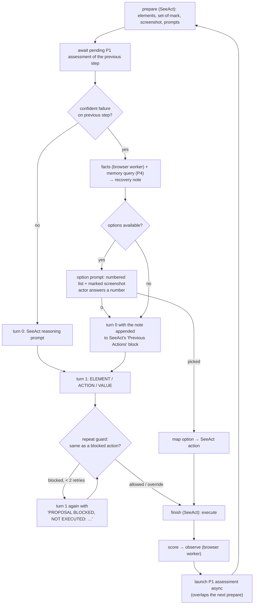

# Attaching the framework to SeeAct: architecture plan

2026-10-13. Status: implemented the same day (`seeact_framework.py`, worker ops `parse`/`act`, system `T`, 6 unit tests); model pilot pending. Decisions D3–D6 taken as proposed below. Companion to
[SEEACT_BASELINE_PLAN.md](SEEACT_BASELINE_PLAN.md) (raw SeeAct, system S) and
[TASK2_FAILURE_AWARE_AGENT_METHOD.md](TASK2_FAILURE_AWARE_AGENT_METHOD.md)
(the framework on Browser Use, system C).

Goal: run the same framework (P1 failure detection, adaptive recovery v3.3,
P4 experience memory) on top of the unmodified SeeAct agent, so the study has
"without / with framework" for two agents. New system id: **T** (SeeAct + Ours).

## 1. Principle: reuse, do not refactor

`live.py` (Browser Use + framework) stays untouched: it is the frozen record of
web-v3. The framework's agent-independent parts are already separate modules
and are called as they are:

| Framework part | Module (unchanged) | What it needs from the agent |
|---|---|---|
| P1 assessment | `model_worker` op `assess`, `assessment.ExecutedTransition` | before/after observation (browser worker), `action_type`, `target`, `value` |
| Trigger gate ≥ 0.9, "scroll that moved is not a dead end" | logic copied verbatim from `live.assess_step` | `page_changed`, action type |
| Recovery note (v3 plain text) | `assessment.recovery_note` | element summary (`tag`, `text`, `attributes`), page facts, memory examples, succeeded steps |
| Page facts | `web_worker` op `facts` | nothing (reads the live page) |
| P4 memory (query, store decision, write) | `model_worker` ops `experience`, `experience_write` | same transition, `controls` from observe |
| Recovery options | option *generation* copied from `live.recovery_options` | a search-box locator and an action *executor* (section 4) |
| Repeat guard | `live.same_action` | an element identity (section 5) |
| Option choice prompt | `native_model.LocalInternVL.choose` logic (plain numbered question) | the current marked screenshot |

Only the glue is new: a SeeAct step loop with the hooks below, about the size
of `seeact_live.py` plus the hook functions. SeeAct's own code is not modified.

## 2. Where the hooks sit in one SeeAct step

Same shape as Browser Use: assess after the step, overlap with the next page
capture, gate at 0.9, note and options before the next decision, guard before
execution. The actor still chooses every action; options are offered, never
forced.

## 3. Building the P1 transition from SeeAct's step

`finish` already returns everything needed:

| Transition field | From SeeAct `finish` result |
|---|---|
| `action_type` | `seeact_common.action_type(action)` (CLICK, TYPE, SELECT, SCROLL, NAVIGATE, PRESS_KEY; HOVER → treat as CLICK-like no-op for P1: skip assessment) |
| `target` | element description string (SeeAct's `description`), or `None` for element-free actions |
| `value` | typed text / GOTO url / `'{"down": false}'`-style scroll marker so `describe_action` and `same_action` keep working |
| `execution_status` | `executed` / `rejected` (SeeAct execution error) |
| `before`, `after` | observations from the browser worker, as today |
| element summary for the note | `{'tag': tag_with_role, 'text': description[:200], 'attributes': {}}` |

Steps with `NONE` (no browser effect) are not assessed, as Browser Use's
`done`/no-op steps were not.

## 4. Recovery options → SeeAct actions

The option list is generated exactly as in `live.recovery_options` (up to 3
goal links, search, scroll-to-top-then-search, Enter to submit, scroll to top,
go back; max 5). Execution maps each to SeeAct's own action vocabulary and is
performed through SeeAct's `perform_action`, so history lines look native:

| Option | SeeAct execution |
|---|---|
| Open goal link *(url)* | `GOTO` url |
| Search the site for *q* | `TYPE` q into the search box element, then (follow-up) `PRESS ENTER`, then (follow-up) results link → `GOTO` |
| Scroll to top and search | `PRESS HOME`, then (follow-up) the search option |
| Press Enter to submit *value* | `PRESS ENTER` |
| Scroll back to the top | `PRESS HOME` |
| Go back | `GO BACK` |

Search-box lookup uses SeeAct's own element list from `prepare` (tag `input`
with `type="search"` or name/placeholder containing "search"), the analogue of
`live.search_box` on Browser Use's selector map. The "scroll to top and search"
variant covers the EPA case where the box is off-screen, exactly as in v3.3.

A chosen option replaces that step's two SeeAct turns (one option call instead
of two actor calls), as it replaced the actor call on Browser Use.

## 5. Repeat guard on SeeAct

Browser Use identified elements by xpath. SeeAct has no xpath, so the identity
is the tuple (`tag_with_role`, normalised `description`): stable across steps
while option letters change. `same_action` is reused with this identity in the
`xpath` slot. Rules unchanged: TYPE also compares the text, SCROLL the
direction, NAVIGATE/PRESS_KEY the value; the blocked list is cleared when the
page path changes; executor-rejected actions are blocked too; at most 2
regenerations, then the actor's choice is executed (override, counted).

The regeneration re-asks **turn 1 only** (the grounding turn) with the block
message appended, keeping SeeAct's turn-0 reasoning.

## 6. Budget and records

| Item | Value (same study rules) |
|---|---|
| Steps | 15 agent steps; 2700 s wall clock (exhaustion = failed result) |
| Model calls per step | 2 actor (+1 option choice when offered, +1 assessment, +1 memory query on incidents, ≤ 2 guard retries); `max_model_calls` 102 is not binding |
| Recovery limits | 15 attempts per episode, as C |
| Memory store | fresh directory for the run; C-style admission threshold |
| Records | all S files plus `assessment-*`, `gate-*`, `note-*`, `memory-*`, `actor-NNNN-choice.json`, `actor-NNNN-guard-*.json`, `experience-*.json`; `result.json` with C's counters |

## 7. Implementation list (when approved)

1. `seeact_worker`: add ops `execute_action(action, element_key, value)` (runs
   `perform_action` for a mapped option) and `elements` already returned by
   `prepare` (search-box lookup happens in the orchestrator). ~40 lines.
2. `seeact_framework.py` (new, .venv): `seeact_framework_episode()` = the S loop
   plus hooks: `assess_step` (copied from live.py, agent-neutral parts), note
   injection into turn 0, option prompt + mapping, guard on turn 1, memory
   open/close. ~250 lines; the assessment/gate/memory code is a verbatim copy
   of `live.assess_step` with Browser Use references removed.
3. `compare_agents.py`: system `T`, dispatch, report rows (T vs S pairs, T vs C).
4. Tests: transition construction, option mapping, guard identity, note
   injection position, loop with scripted failure → note → option → execution.
5. Pilot 5 tasks (same 5 as the S pilot) → full run `web-v5-seeact-ours`
   (84 T episodes; S from web-v4 is the paired baseline, same plan).

Estimate: 1–1.5 days code and tests, 0.5 day pilot, 1 lab day full run.

## 8. Decisions to confirm

- **D3 note placement:** appended as a paragraph after SeeAct's "Previous
  Actions" list in turn 0 (the natural place in its prompt). Alternative: a
  separate user message; rejected because SeeAct's engine layout is fixed.
- **D4 option prompt:** same wording and "0 = decide myself" as on Browser Use,
  with the marked screenshot, so the two agents receive identical recovery
  interfaces.
- **D5 HOVER / NEW TAB / CLOSE TAB:** not assessed (no page-state intent);
  logged only.
- **D6 pairing for the paper:** T is paired with S from web-v4 (same plan,
  different week). If site drift is a concern, rerun S interleaved with T
  (168 episodes, ~2 lab days) instead of 84.

## 9. What this adds to the paper

Table: completion for Browser Use, Browser Use + Ours, SeeAct, SeeAct + Ours
on the same 84 paired episodes; rescue and harm rates per agent. Claim: the
framework attaches to two different open-source agents through a thin adapter
and improves both (if the result holds), with the assessor, note, facts and
memory code shared unchanged between the two.
